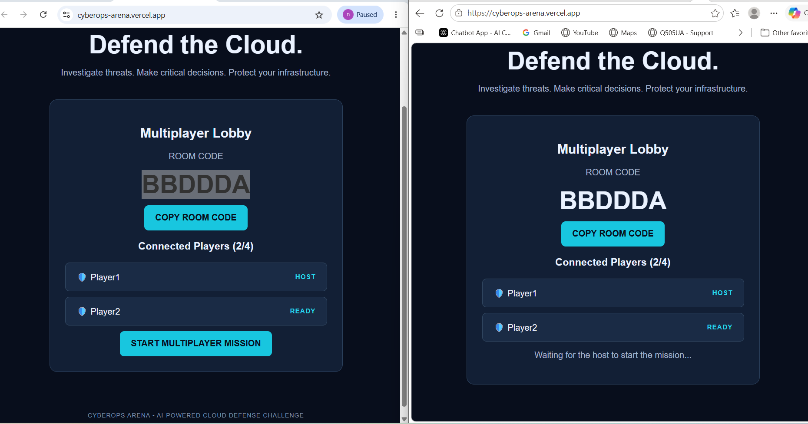
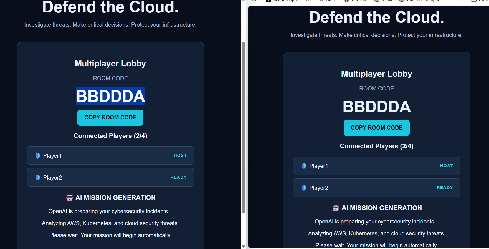
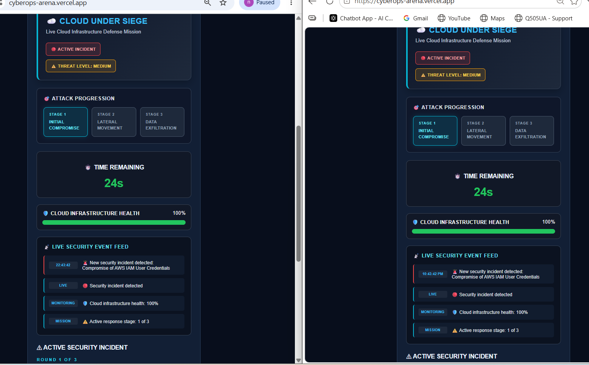
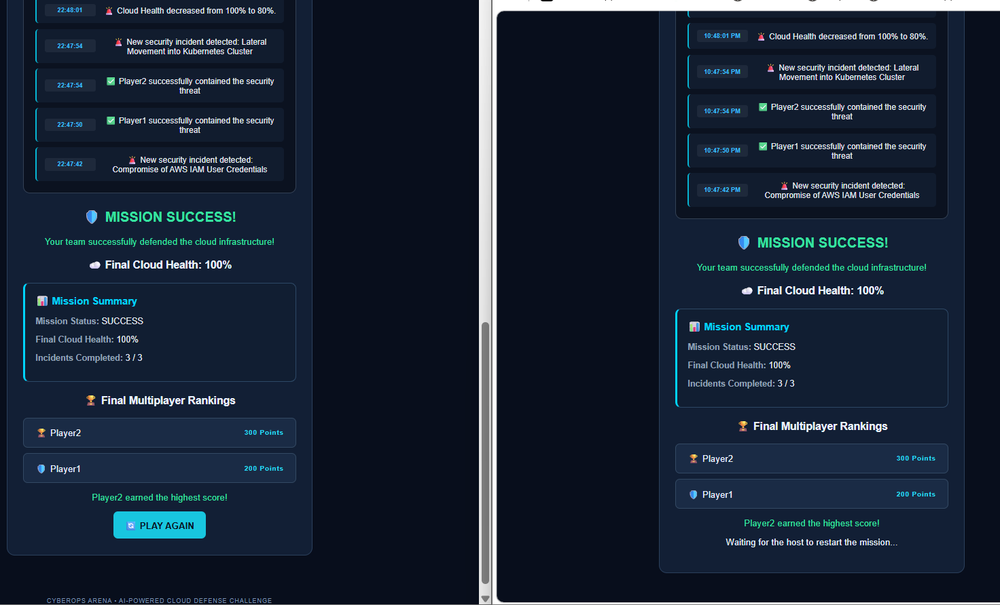
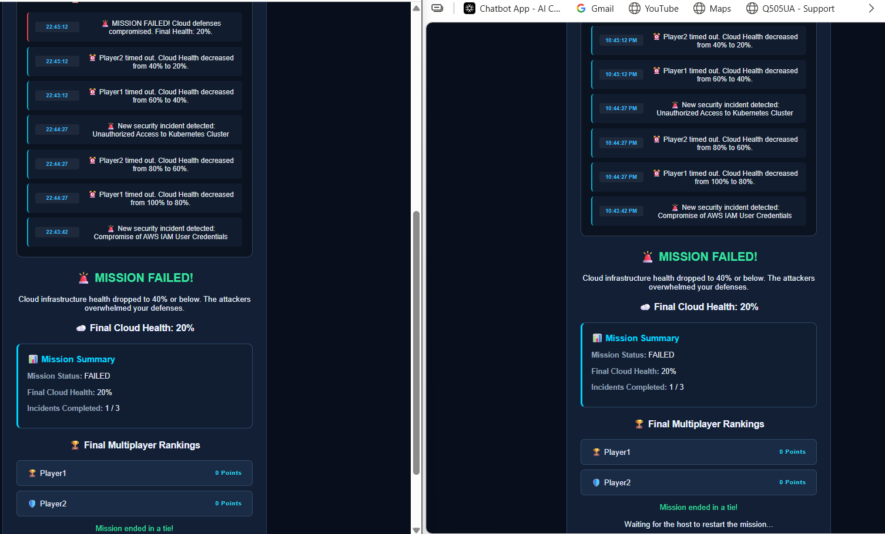

# 🛡️ CyberOps Arena: Cloud Under Siege

### AI-Powered Multiplayer Cloud Cybersecurity Defense Game

CyberOps Arena is a real-time multiplayer cybersecurity simulation where players work together to defend cloud infrastructure against evolving security threats.

The game combines artificial intelligence, cloud security concepts, incident response, and collaborative decision-making to create an interactive learning experience.

**🎮 Live Application:** https://cyberops-arena.vercel.app

**Backend Hosting:** Render  
**Frontend Hosting:** Vercel

---

## 🎯 Project Overview

CyberOps Arena challenges players to investigate and respond to cybersecurity incidents affecting cloud infrastructure.

Players join a shared multiplayer room and make security decisions under time pressure. Their responses affect individual scores, player health, and the overall health of the cloud environment.

The objective is to successfully defend the infrastructure against three consecutive security incidents.

## ✨ Key Features

### 🤖 AI-Generated Cybersecurity Incidents

- Uses the OpenAI API to generate cybersecurity scenarios.
- Includes threats involving AWS, Kubernetes, identity and access management, and cloud infrastructure.
- Generates new incident scenarios when starting or restarting missions.
- Provides multiple-choice incident response decisions.
- Includes fallback scenarios when AI generation is unavailable.

### 👥 Real-Time Multiplayer

- Supports 2–4 players per room.
- Generates unique six-character room codes.
- Allows players to create or join rooms.
- Synchronizes gameplay through Socket.IO.
- Provides host-controlled mission starting and restarting.
- Displays connected players and their roles.

### 🛡️ Shared Cloud Infrastructure Health

- Players collaborate to protect a shared cloud environment.
- Correct decisions can restore Cloud Health.
- Incorrect decisions and timeouts reduce Cloud Health.
- The team loses when Cloud Health reaches 40% or below.
- The mission succeeds when all three incidents are completed and Cloud Health remains above the failure threshold.

### ⏱️ Timed Incident Response

- Each incident has a 45-second response timer.
- The countdown is synchronized between players.
- Players who fail to respond before the deadline receive penalties.

### 🖥️ Security Operations Center Dashboard

The game includes a cybersecurity operations dashboard featuring:

- Live threat indicators.
- Attack progression stages.
- Countdown timer.
- Cloud infrastructure health monitoring.
- Real-time security event feed.
- Active cybersecurity incidents.
- Multiplayer leaderboard.

### 🏆 Mission Results and Rankings

At the end of each mission, players receive:

- Mission Success or Mission Failed status.
- Final Cloud Health percentage.
- Number of completed incidents.
- Individual player scores.
- Final multiplayer rankings.
- Host-controlled Play Again functionality.

## 🏗️ System Architecture

CyberOps Arena uses a frontend/backend architecture.

```text
              Players
                 |
                 v
       React + Vite Frontend
          Hosted on Vercel
                 |
          Socket.IO Client
                 |
                 v
       Express + Socket.IO
          Hosted on Render
                 |
          Game Room State
                 |
                 v
             OpenAI API
                 |
                 v
       AI-Generated Incidents
```

The backend manages multiplayer rooms, game state, scoring, timers, Cloud Health, and incident generation.

The frontend provides the interactive user interface and receives real-time game updates from the backend.

## 🛠️ Technology Stack

| Component | Technology |
|---|---|
| Frontend | React 19 |
| Frontend Build Tool | Vite 8 |
| Backend | Node.js |
| Backend Framework | Express 5 |
| Real-Time Communication | Socket.IO 4.8 |
| Artificial Intelligence | OpenAI API |
| Backend Configuration | dotenv |
| Cross-Origin Communication | CORS |
| Frontend Deployment | Vercel |
| Backend Deployment | Render |
| Version Control | Git and GitHub |

## 📁 Project Structure

```text
cyberops-arena/
│
├── frontend/
│   ├── src/
│   │   ├── App.jsx
│   │   ├── App.css
│   │   └── ...
│   ├── package.json
│   └── ...
│
├── backend/
│   ├── server.js
│   ├── package.json
│   └── ...
│
└── README.md
```

## 🚀 Running the Project Locally

### Prerequisites

- Node.js and npm
- Git
- An OpenAI API key

### 1. Clone the Repository

```bash
git clone https://github.com/Rene-Ngong-N/cyberops-arena.git
cd cyberops-arena
```

### 2. Configure the Backend

Navigate to the backend directory:

```bash
cd backend
npm install
```

Create a `.env` file inside `backend/`:

```env
OPENAI_API_KEY=your_openai_api_key
PORT=3001
```

Start the backend:

```bash
npm start
```

### 3. Configure the Frontend

Open another terminal and navigate to the frontend directory:

```bash
cd frontend
npm install
```

Create a `.env` file inside `frontend/`:

```env
VITE_SERVER_URL=http://localhost:3001
```

Start the frontend:

```bash
npm run dev
```

Open the local URL displayed by Vite, normally:

```text
http://localhost:5173
```

**Windows PowerShell note:** If PowerShell blocks the npm script, use `npm.cmd` instead of `npm`.

## 🎮 How to Play

1. Open the CyberOps Arena application.
2. Enter a player name.
3. Create a multiplayer room.
4. Share the room code with another player.
5. Have the second player join using the room code.
6. The host starts the multiplayer mission.
7. Wait for the AI to prepare the cybersecurity incidents.
8. Investigate each incident and select the best response.
9. Protect the shared Cloud Health while earning points.
10. Complete all three incidents to achieve Mission Success.

The host can select **Play Again** to begin another mission.

## ☁️ Production Deployment

### Backend — Render

The backend is deployed as a Node.js web service.

Configuration:

```text
Root Directory: backend
Build Command: npm install
Start Command: npm start
```

Required environment variable:

```text
OPENAI_API_KEY
```

The API key is configured securely through the hosting platform rather than being committed to GitHub.

### Frontend — Vercel

The frontend is deployed using the Vite framework preset.

Configuration:

```text
Root Directory: frontend
Framework Preset: Vite
```

Required environment variable:

```text
VITE_SERVER_URL=https://cyberops-arena-backend.onrender.com
```

**Live Game:** https://cyberops-arena.vercel.app

## 🧪 Testing and Validation

The following functionality has been tested during development and production verification:

- Multiplayer room creation and joining.
- Two-player real-time synchronization.
- Host-controlled mission starting.
- AI mission generation interface.
- Cybersecurity incident response.
- Synchronized countdown timers.
- Shared Cloud Health updates.
- Mission Success conditions.
- Mission Failed conditions.
- Individual player scoring.
- Final multiplayer rankings.
- Mission Summary synchronization.
- Play Again functionality.
- Production frontend/backend connectivity.
- Responsive interface testing.

## 🔐 Security Considerations

- OpenAI API keys are stored in environment variables.
- Backend secrets are not required in the frontend.
- The backend controls authoritative multiplayer game state.
- Room codes are used to coordinate multiplayer sessions.
- Production frontend and backend are deployed as separate services.

This project is an educational simulation and is not intended to replace enterprise security monitoring or incident response systems.
## 📸 Gameplay Screenshots

The following screenshots demonstrate CyberOps Arena running in production with two synchronized multiplayer sessions.

### 1. Multiplayer Lobby

Players create or join a room using a unique six-character code. The host controls when the mission begins.



### 2. AI Mission Generation

Both players see the AI mission preparation screen before gameplay begins.



### 3. Security Operations Center Dashboard

The live SOC dashboard displays attack progression, threat indicators, synchronized countdown timers, Cloud Health, and security events.



### 4. Mission Success

The team successfully completes all three incidents. The Mission Summary displays final Cloud Health, individual scores, and player rankings.



### 5. Mission Failed

The mission ends when Cloud Health reaches the failure threshold. Both players receive synchronized results and final rankings.



---
## 🔮 Future Improvements

Potential enhancements include:

- Additional cloud security incident categories.
- Multiple difficulty levels.
- Player authentication and persistent profiles.
- Historical mission statistics.
- Expanded cybersecurity training content.
- More advanced AI-generated incident sequences.
- Enhanced mobile gameplay experience.

## 👨‍💻 Project Author

**Rene N**

CyberOps Arena was developed as an interactive project combining software engineering, cloud technologies, artificial intelligence, and cybersecurity education.

---

**CyberOps Arena — Investigate threats. Make critical decisions. Defend the cloud.**